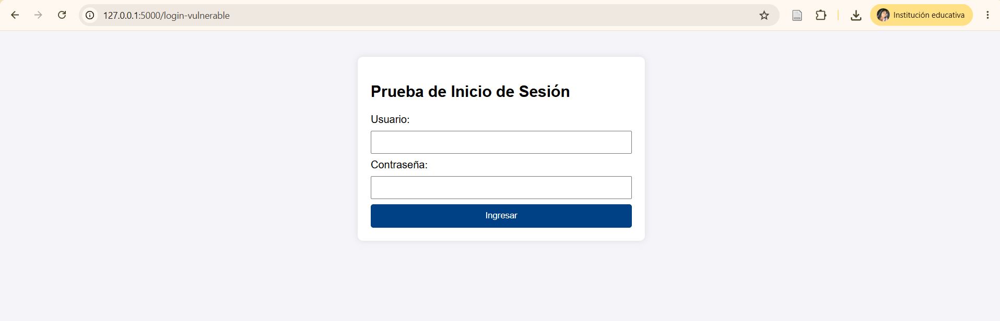
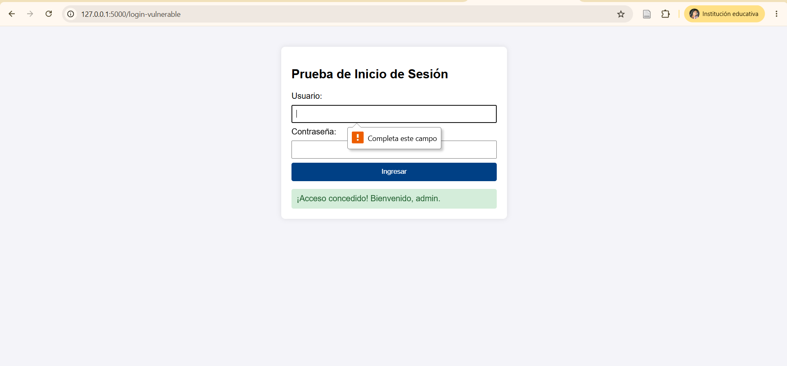
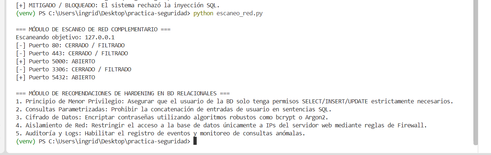
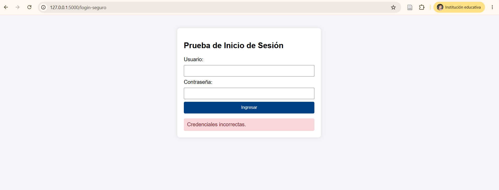
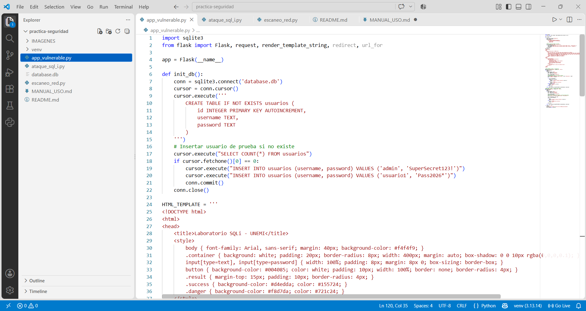

# 🛠️ Manual de uso – Seguridad Informática: SQL Injection, escaneo de red y hardening

**Asignatura:** Seguridad Informática  
**Práctica:** Trabajo Práctico Experimental 4  
**Docente:** Ing. Alex Armando Ávila Coello  
**Carrera:** Tecnologías de la Información – UNEMI  
**Autor:** Grupo 6  

Este manual explica, paso a paso, cómo descargar el proyecto, preparar Python, instalar las dependencias, ejecutar la aplicación web, realizar las pruebas académicas de SQL Injection y utilizar los módulos complementarios. También incluye las capturas de pantalla almacenadas en la carpeta `capturas`.

> **Aviso de seguridad:** realice estas pruebas únicamente en su propio equipo, en una máquina virtual o en un entorno para el que tenga autorización. La aplicación vulnerable es exclusivamente didáctica. No la exponga a Internet.

---

## 📋 Tabla de contenidos

1. [Requisitos previos](#1-requisitos-previos)
2. [Descargar o clonar el proyecto](#2-descargar-o-clonar-el-proyecto)
3. [Abrir el proyecto en Visual Studio Code](#3-abrir-el-proyecto-en-visual-studio-code)
4. [Crear y activar el entorno virtual](#4-crear-y-activar-el-entorno-virtual)
5. [Instalar las dependencias](#5-instalar-las-dependencias)
6. [Ejecutar la aplicación web](#6-ejecutar-la-aplicacion-web)
7. [Probar los módulos de inicio de sesión](#7-probar-los-modulos-de-inicio-de-sesion)
8. [Ejecutar el script de prueba SQL Injection](#8-ejecutar-el-script-de-prueba-sql-injection)
9. [Consultar el módulo de facturas](#9-consultar-el-modulo-de-facturas)
10. [Ejecutar el escaneo de puertos y recomendaciones de hardening](#10-ejecutar-el-escaneo-de-puertos-y-recomendaciones-de-hardening)
11. [Evidencias de ejecución](#11-evidencias-de-ejecucion)
12. [Solución de problemas frecuentes](#12-solucion-de-problemas-frecuentes)
13. [Estructura del proyecto](#13-estructura-del-proyecto)

---

## 1. Requisitos previos

Antes de iniciar, compruebe que el equipo tenga instalados los siguientes programas:

| Programa | Uso |
|---|---|
| Python 3 | Ejecutar los archivos `.py`. |
| Git | Clonar el repositorio desde GitHub. |
| Visual Studio Code | Abrir y editar el código fuente. |
| Navegador web | Acceder a la aplicación local. |

### Paso 1.1. Verificar Python

1. Abra el menú Inicio de Windows.
2. Escriba `cmd` o abra la terminal de Visual Studio Code.
3. Ejecute:

```bash
python --version
```

4. Debe aparecer una versión de Python 3.x.

Si el comando no funciona, pruebe:

```bash
py --version
```

**Resultado esperado:** se muestra la versión instalada de Python. Si ninguno de los dos comandos funciona, instale Python y active la opción para agregarlo al PATH durante la instalación.

### Paso 1.2. Verificar Git

En la misma terminal, escriba:

```bash
git --version
```

**Resultado esperado:** Git muestra el número de versión. Si no se reconoce el comando, instale Git antes de continuar.

---

## 2. Descargar o clonar el proyecto

Puede obtener el proyecto mediante Git o descargarlo como archivo ZIP desde GitHub.

### Paso 2.1. Clonar el repositorio

1. Abra Visual Studio Code o una terminal.
2. Ubíquese en la carpeta donde desea guardar el proyecto.
3. Ejecute el siguiente comando:

```bash
git clone https://github.com/ichacinr-blip/Grupo-6practica-seguridad-.git
```

4. Ingrese a la carpeta descargada:

```bash
cd Grupo-6practica-seguridad-
```

> Si el repositorio cambia de dirección o el enlace anterior deja de estar disponible, copie la URL actual desde el botón **Code** de GitHub.

### Paso 2.2. Alternativa: descargar el ZIP

1. Ingrese al repositorio en GitHub.
2. Presione el botón **Code**.
3. Seleccione **Download ZIP**.
4. Abra la carpeta Descargas.
5. Haga clic derecho sobre el ZIP y seleccione **Extraer todo**.
6. Guarde la carpeta extraída en una ubicación fácil de encontrar.

---

## 3. Abrir el proyecto en Visual Studio Code

1. Abra Visual Studio Code.
2. Seleccione **Archivo → Abrir carpeta**.
3. Busque la carpeta del proyecto y selecciónela.
4. En el panel izquierdo deben aparecer los archivos del proyecto, entre ellos:
   - `app_vulnerable.py`
   - `ataque_sql_i.py`
   - `escaneo_red.py`
   - `database.db`
   - `MANUAL_USO.md`
   - `README.md`
   - La carpeta `capturas`.
5. Abra **Terminal → Nueva terminal**.

**Resultado esperado:** el explorador de Visual Studio Code muestra los archivos y la terminal queda ubicada en la carpeta del proyecto.

---

## 4. Crear y activar el entorno virtual

El entorno virtual permite instalar las bibliotecas del proyecto sin modificar las instalaciones generales de Python.

### Paso 4.1. Crear el entorno

En la terminal de Visual Studio Code, ejecute:

```bash
python -m venv venv
```

Si utiliza el lanzador de Windows, también puede ejecutar:

```bash
py -m venv venv
```

### Paso 4.2. Activar el entorno en Windows PowerShell

```powershell
.\venv\Scripts\Activate.ps1
```

Si PowerShell bloquea la activación por la política de ejecución, puede habilitarla solo para la terminal actual con:

```powershell
Set-ExecutionPolicy -Scope Process -ExecutionPolicy Bypass
```

Después, vuelva a ejecutar:

```powershell
.\venv\Scripts\Activate.ps1
```

### Paso 4.3. Activar el entorno en CMD

Si utiliza el Símbolo del sistema (CMD), ejecute:

```cmd
venv\Scripts\activate.bat
```

**Resultado esperado:** al inicio de la línea de comandos aparece `(venv)`, lo que indica que el entorno virtual está activo.

---

## 5. Instalar las dependencias

Con el entorno virtual activado, ejecute:

```bash
python -m pip install --upgrade pip
python -m pip install flask requests
```

- **Flask:** permite ejecutar la aplicación web local.
- **Requests:** permite que el script de prueba envíe solicitudes HTTP al servidor.

Para comprobar la instalación:

```bash
python -m pip show flask
python -m pip show requests
```

**Resultado esperado:** la terminal muestra la información de ambas bibliotecas sin indicar que el paquete está ausente.

---

## 6. Ejecutar la aplicación web

### Paso 6.1. Iniciar el servidor

1. Confirme que el entorno virtual esté activo.
2. En la terminal, ejecute:

```bash
python app_vulnerable.py
```

3. Espere el mensaje que indica que el servidor se está ejecutando en el puerto 5000.
4. No cierre esta terminal mientras realiza las pruebas.

### Paso 6.2. Abrir la aplicación en el navegador

1. Abra Chrome, Edge o Firefox.
2. Escriba esta dirección:

```text
http://127.0.0.1:5000
```

3. Presione Enter.

**Resultado esperado:** se muestra la página principal del sistema con las opciones de inicio de sesión vulnerable, inicio de sesión seguro y módulo de facturas.



---

## 7. Probar los módulos de inicio de sesión

La aplicación dispone de dos formularios para comparar una consulta SQL vulnerable con otra que utiliza parámetros.

### Paso 7.1. Probar el inicio de sesión vulnerable

1. En el menú principal, seleccione **Login Vulnerable (SQLi)**.
2. Se abrirá el formulario de acceso.
3. Ingrese las credenciales de prueba:
   - Usuario: `admin`
   - Clave: `admin123`
4. Presione **Ingresar**.
5. Compruebe el mensaje que muestra la aplicación.



### Paso 7.2. Probar el inicio de sesión seguro

1. Regrese al menú principal.
2. Seleccione **Login Seguro**.
3. Ingrese las mismas credenciales de prueba:
   - Usuario: `admin`
   - Clave: `admin123`
4. Presione **Ingresar**.
5. Compruebe que la aplicación permita el acceso con las credenciales correctas.

**¿Cuál es la diferencia?** El módulo vulnerable construye la consulta SQL concatenando los datos ingresados. El módulo seguro utiliza una consulta parametrizada (`?`), que separa los valores introducidos por el usuario de las instrucciones SQL.

> Este proyecto es una demostración académica. No utilice estas credenciales ni este mecanismo de autenticación en un sistema real.

---

## 8. Ejecutar el script de prueba SQL Injection

Este módulo envía solicitudes a las rutas localizadas en `127.0.0.1` para comparar el comportamiento de los dos formularios.

### Paso 8.1. Mantener activo el servidor

Antes de ejecutar la prueba, confirme que `app_vulnerable.py` continúa funcionando en una terminal. Si está detenido, vuelva a iniciarlo:

```bash
python app_vulnerable.py
```

### Paso 8.2. Abrir una segunda terminal

En Visual Studio Code, seleccione **Terminal → Nueva terminal**. Si el entorno virtual no aparece activo en la nueva terminal, actívelo nuevamente.

### Paso 8.3. Ejecutar la prueba

```bash
python ataque_sql_i.py
```

### Paso 8.4. Revisar los resultados

El script muestra el resultado de las solicitudes realizadas a las rutas vulnerable y segura. Compare los mensajes de la terminal y compruebe que la prueba distingue entre el comportamiento de ambas rutas.



**Importante:** el script debe enviar los nombres de campos que espera el formulario (`usuario` y `clave`). Si utiliza `username` y `password`, la aplicación recibirá valores vacíos y la prueba no será válida.

---

## 9. Consultar el módulo de facturas

1. Abra nuevamente el menú principal en `http://127.0.0.1:5000`.
2. Seleccione **Módulo de Facturas**.
3. Se mostrará una tabla con los registros de prueba almacenados en SQLite.
4. Revise las columnas:
   - ID.
   - Número de factura.
   - Cliente.
   - Monto.
   - Fecha.
5. Utilice el enlace **Volver al inicio** para regresar al menú principal.

La base de datos `database.db` almacena las tablas de usuarios y facturas. La aplicación crea las tablas y los registros de ejemplo cuando se inicia por primera vez y las tablas todavía no existen o están vacías.

---

## 10. Ejecutar el escaneo de puertos y recomendaciones de hardening

El archivo `escaneo_red.py` contiene dos funciones: una para comprobar puertos TCP y otra para mostrar recomendaciones de protección de bases de datos.

### Paso 10.1. Ejecutar el módulo

En una terminal independiente, ejecute:

```bash
python escaneo_red.py
```

### Paso 10.2. Interpretar la salida

El programa realiza una prueba local sobre `127.0.0.1` y revisa los puertos configurados en el código:

- `80`: HTTP.
- `443`: HTTPS.
- `5000`: puerto utilizado por la aplicación Flask.
- `3306`: puerto habitual de MySQL.
- `5432`: puerto habitual de PostgreSQL.

Un puerto que aparece como **ABIERTO** acepta la conexión TCP desde el equipo que ejecuta la prueba. Un resultado **CERRADO / FILTRADO** significa que la conexión no pudo establecerse; por sí solo no permite distinguir entre un puerto cerrado y uno filtrado.

### Paso 10.3. Revisar las recomendaciones de hardening

Al finalizar el escaneo, el programa presenta recomendaciones como:

1. Aplicar el principio de menor privilegio.
2. Utilizar consultas parametrizadas.
3. Cifrar las contraseñas con algoritmos apropiados, como bcrypt o Argon2.
4. Restringir el acceso a la base de datos mediante reglas de red.
5. Habilitar auditoría y registros de eventos.



---

## 11. Evidencias de ejecución

Las evidencias se encuentran dentro de la carpeta `capturas`. Para visualizarlas desde GitHub, abra este manual en la pestaña **Preview** o **Vista previa**.

### 11.1. Código fuente en Visual Studio Code

Esta captura permite identificar el archivo de código y observar la estructura de las funciones implementadas.



### 11.2. Evidencias complementarias

Las imágenes anteriores documentan el menú, el ingreso de datos, la ejecución de pruebas y el resumen de resultados. Si se agregan nuevas capturas, guárdelas en `capturas` y utilice rutas relativas con este formato:

```markdown

```

**Recomendación:** mantenga los nombres de los archivos exactamente iguales a los que aparecen en las rutas del manual. GitHub distingue entre mayúsculas y minúsculas en los nombres de archivo.

---

## 12. Solución de problemas frecuentes

| Problema | Posible solución |
|---|---|
| `python` no se reconoce | Compruebe la instalación de Python y pruebe `py --version`. |
| No se activa `venv` en PowerShell | Ejecute la instrucción de `Set-ExecutionPolicy -Scope Process -ExecutionPolicy Bypass` indicada en la sección 4. |
| `No module named flask` | Active el entorno e instale con `python -m pip install flask requests`. |
| `No module named requests` | Ejecute `python -m pip install requests`. |
| Error de conexión en el script de prueba | Compruebe que el servidor Flask esté activo en `127.0.0.1:5000`. |
| El puerto 5000 está ocupado | Cierre el proceso que lo utiliza o configure otro puerto en `app_vulnerable.py` y actualice las URL de `ataque_sql_i.py`. |
| No aparecen las imágenes en GitHub | Compruebe que los archivos estén dentro de `capturas` y que las rutas relativas coincidan exactamente. |
| El enlace de la tabla de contenido no funciona | Compruebe que el título de destino exista y que el enlace use el identificador generado por GitHub. |

---

## 13. Estructura del proyecto

La carpeta del proyecto debe conservar una organización similar a la siguiente:

```text
Grupo-6practica-seguridad/
│
├── capturas/
│   ├── 01_menu_inicial.png
│   ├── 02_ingreso_datos.png
│   ├── 03_escaneo.png
│   ├── 04_resumen.png
│   └── 05_codigo.png
│
├── MANUAL_USO.md
├── README.md
├── app_vulnerable.py
├── ataque_sql_i.py
├── escaneo_red.py
└── database.db
```

**Fin del manual.** Se recomienda conservar juntos el archivo `MANUAL_USO.md` y la carpeta `capturas`, ya que las imágenes se cargan mediante rutas relativas.
